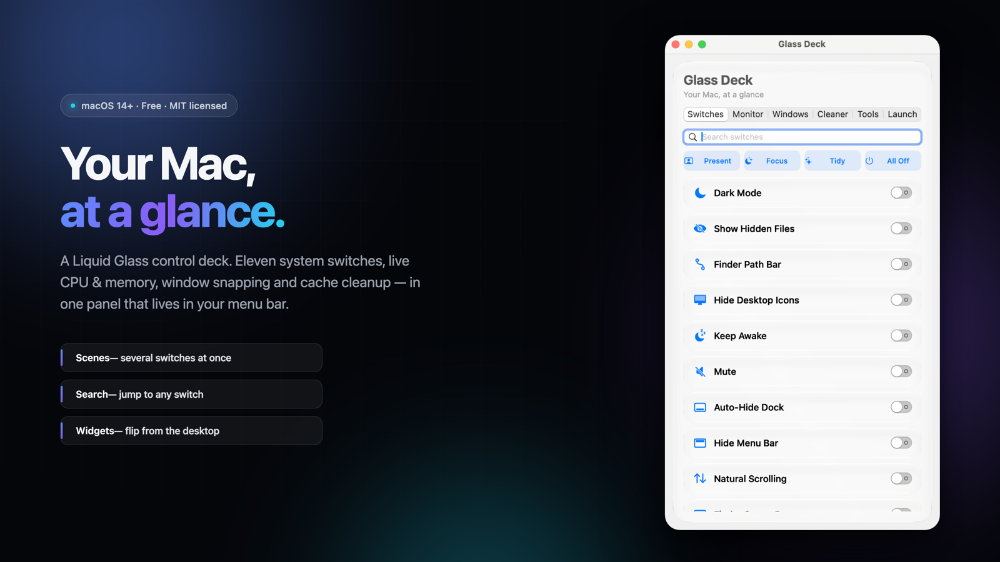
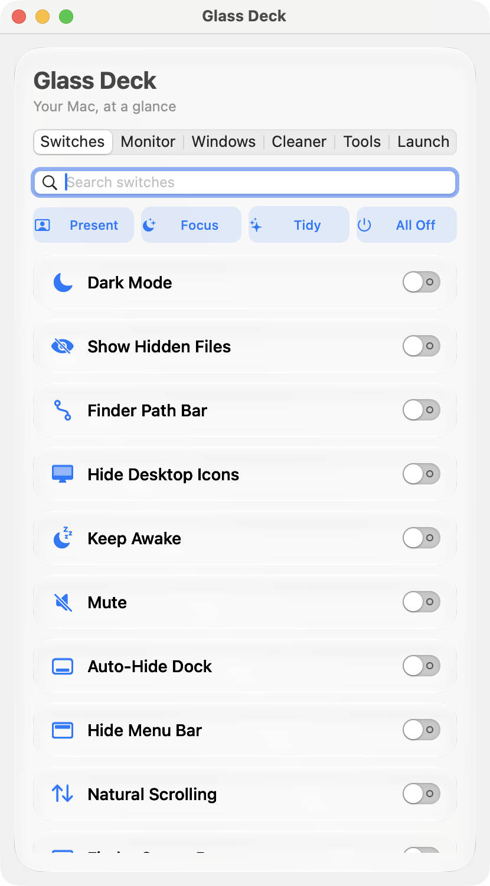

<div align="center">



# Glass Deck

**Eleven system switches, a clipboard shelf, live monitoring and cache cleanup — in one glass panel in your menu bar.**

[](https://aarongame.com)
[](https://github.com/Aaron-CNSD/GlassDeck/releases/latest)
[](LICENSE)
[](Sources/GlassDeck/Localization.swift)
[](https://github.com/Aaron-CNSD/GlassDeck/releases/latest)

[**Download**](https://github.com/Aaron-CNSD/GlassDeck/releases/latest) &nbsp;·&nbsp; [Website](https://aarongame.com) &nbsp;·&nbsp; [Changelog](https://github.com/Aaron-CNSD/GlassDeck/releases)

</div>

---

## New in 1.6.1

A **clipboard shelf** in the panel. Copy anything anywhere and the last 60 text clips are already there when you open Glass Deck: click a row to put it back on the pasteboard, pin the ones you paste daily so they never age out, delete the rest. History is written to `~/Library/Application Support/GlassDeck/clipboard.json` on this Mac only — nothing leaves the machine. Anything a password manager marks as confidential is skipped and never recorded, and the record switch at the top of the tab turns the whole thing off.

The tab bar is now icon-only with tooltips, because seven labelled segments no longer fit in a 380 pt panel and truncating "Clipb…" helps nobody.

## New in 1.6.0

The app added the offline workspace. Switch between **System controls** and **Workspace** in the main window, or open Workspace from the menu bar's right-click menu. Focus timers, tasks, notes and tools are bundled inside the app and do not need a web server. JSON/TXT exports use macOS Save dialogs and backups can be imported through a file picker. Native and browser data are separate; transfer them using backup export/import. The workspace interface is currently in Simplified Chinese; native system controls retain their existing five languages.

## Cross platform web app

Glass Deck now includes a buildless PWA in `website/app/` with focus timers, tasks, autosaved notes, backup import/export, unit conversion, text statistics and JSON formatting. It runs in modern browsers on Windows, Linux, macOS, iOS and iPadOS; installation varies by browser. The macOS system controls remain in the native app. Data stays in the current browser and does not sync automatically.

Run `npm test` and `python3 -m http.server 4173 --directory website`, then open `http://localhost:4173/app/`. See [web app documentation](docs/WEB_APP.md) for offline behavior, installation, limitations and deployment.

## Install

```bash
brew tap Aaron-CNSD/tap
brew trust Aaron-CNSD/tap          # Homebrew 5+ asks before running third-party casks
brew install --cask glassdeck
```

Or grab the DMG directly: **[Glass.Deck.v1.6.1.dmg](https://github.com/Aaron-CNSD/GlassDeck/releases/latest/download/Glass.Deck.v1.6.1.dmg)** → drag to Applications → click the glass prism in the menu bar.

<details>
<summary><b>macOS says “Glass Deck is damaged” or “cannot be opened”?</b> — click here</summary>

<br>

Glass Deck is open source and **not notarized** (that needs a $99/year Apple Developer account). macOS quarantines unsigned downloads, so you have to clear the flag once:

```bash
xattr -dr com.apple.quarantine "/Applications/GlassDeck.app"
```

Then open it normally. Homebrew users are unaffected — Homebrew clears the flag for you.

</details>

**No telemetry. No account. No network calls except the ones you ask for.** 2.8 MB universal binary (Apple Silicon **and** Intel) — this is AppKit, not Electron.

---

## Why another switch app?

There are good ones already ([OnlySwitch](https://github.com/jacklandrin/OnlySwitch) is the classic). Glass Deck exists because of four specific annoyances:

| Annoyance | What Glass Deck does |
| --- | --- |
| Flipping four switches one at a time before a meeting | **Scenes** — Present / Focus / Tidy / All Off, one click |
| Scrolling a dozen capsules hunting for one toggle | **Search** — type three letters, the list filters |
| Digging through the panel to reach the same switches daily | **Desktop widgets** (small / medium / large) + a **menu bar** scene menu |
| “Cache cleaner” apps that show a scary number then ask for money | **Cleaner** that lists exactly what it will delete, and deletes only that |

And one technical point: on macOS 26+ the panel uses **`NSGlassEffectView`** — the OS renders the real refractive glass, including the self-lit rim. It is not a hand-rolled blur. On macOS 14–15 it falls back to `NSVisualEffectView`.

## What's inside

<table>
<tr><td width="50%" valign="top">

**Switches (11)**
🌙 Dark Mode · 👁️ Hidden Files · 📁 Finder Path Bar · 🖥️ Hide Desktop Icons · 😴 Keep Awake · 🔇 Mute · 🚢 Auto-Hide Dock · 📊 Hide Menu Bar · 🖱️ Natural Scrolling · 📊 Status Bar · 🔤 File Extensions

**Monitor**
Live CPU / memory / network throughput, read through the public `host_statistics` API — no kernel extensions, no private frameworks.

</td><td width="50%" valign="top">

**Windows**
Every running app in a list, with *bring to front* and **force quit** — the button macOS doesn't give you.

**Cleaner**
Scans Xcode DerivedData, Homebrew / CocoaPods / SwiftPM caches, tells you what each one weighs before you commit.

**Clipboard**
Your last 60 text clips, pinned or not, searchable by eye and one click from the pasteboard. Password-manager items are skipped.

**Tools**
Screenshot, screen recording, and **clipboard OCR** (Vision framework — copy an image, get text back).

**Launch**
Pin the URLs, files and commands you open ten times a day.

</td></tr>
</table>

### Scenes

| Scene | What it flips |
| --- | --- |
| 🎬 **Present** | Hide desktop icons · auto-hide Dock · hide menu bar |
| 🌙 **Focus** | Mute · hide desktop icons |
| ✨ **Tidy** | Hidden files off · path bar off · status bar off · extensions off |
| ⏻ **All Off** | Every switch in the deck |

## Screenshot

<p align="center"></p>

## Languages

English · 简体中文 · 繁體中文 · 日本語 · 한국어 — auto-detected from the system, overridable from the menu.

## Build from source

```bash
git clone https://github.com/Aaron-CNSD/GlassDeck.git
cd GlassDeck
./build-app.sh                 # app only, no Xcode required
open build/GlassDeck.app
```

For the widget extension you need full Xcode:

```bash
xcodegen generate && open GlassDeck.xcodeproj   # ⌘R
```

<details>
<summary>Project layout</summary>

```
Sources/GlassDeck/     Main app (pure AppKit)
  GlassPanel.swift       Liquid Glass surface (NSGlassEffectView)
  DeckViewController.swift  The panel layout
  Scenes.swift           Multi-switch presets
  ClipboardStore.swift   Clipboard history + persistence
  SystemController.swift System state read/write
  Localization.swift     5-language string tables
Sources/Shared/        Model shared with the widget
Widget/                WidgetKit extension (3 sizes)
website/               Landing page (Cloudflare Worker)
```
</details>

## How the glass works

```swift
if #available(macOS 26.0, *) {
    let glass = NSGlassEffectView()
    glass.cornerRadius = 24
    glass.contentView = myContent      // content goes HERE…
} else {
    let effect = NSVisualEffectView()  // …frosted fallback
    effect.material = .hudWindow
}
```

The one rule from Apple's guidance: **put content into `contentView`, never `addSubview` onto the glass** — only `contentView` is guaranteed to sit inside the glass layer.

## Contributing

Adding a switch is a dozen lines — append a `Toggle` and its translations:

```swift
Toggle(id: "mynewtoggle", title: L.t(.myNewToggle), symbol: "sparkles",
       isOn: { /* read state */ },
       setState: { /* apply state */ })
```

Ideas that would help most: more scenes, per-scene hotkeys, a Shortcuts/App Intents bridge, Spanish and German translations. Open an issue before a big PR so we don't collide.

## License

[MIT](LICENSE) © 2026 Aaron

<div align="center"><br>

If Glass Deck earns a place in your menu bar, **a ⭐ helps other people find it** — it is the only signal that ranks a small project above the noise.

</div>
